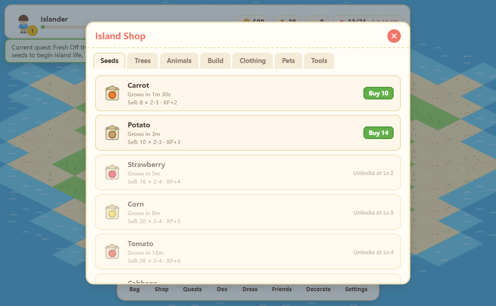

# Paradise Isle

An island life-sim for the browser: farm, raise animals, fish, fight off wild beasts, dress up and visit neighbours, with progress saved in your browser and no account.

**Play it here: https://appleweiping.github.io/paradise-isle/** (desktop or phone)


It is a homage to QQ天堂岛, a 2011 Chinese web game. The rules are rebuilt from how that game played; all code, art, text and numbers here are new.

[中文说明](README.zh-CN.md)

## Controls

| Action | Mouse | Touch |
|---|---|---|
| Do something with a tile, animal, beast or the water's edge | Click it. Your islander walks over and a small menu appears (plant, water, harvest, feed, fight, fish...) | Tap it |
| Move the camera | Drag | Drag with one finger |
| Zoom | Mouse wheel | Pinch with two fingers |
| Close a menu or panel | `Esc`, or click outside it | Tap outside it |
| Bag, shop, quests, collection, wardrobe, friends, decorate, settings | Bottom toolbar | Same |
| Switch language | `EN` / `中文` button on the title screen, or Settings in game | Same |

Crops and animals run on the real clock: a carrot takes 90 seconds, later crops take hours, and things keep growing while the tab is closed. When you come back, a summary shows what happened while you were away.



| A built-up island at noon | The same island at night |
|---|---|
|  |  |

The two island screenshots were taken with the Chinese UI; the language follows your browser and can be switched at any time.

## Run it locally

Needs Node.js 20 or newer.

```bash
git clone https://github.com/appleweiping/paradise-isle.git
cd paradise-isle
npm install
npm run dev      # http://localhost:5173
npm test         # 75 unit tests (Vitest)
npm run build    # type check + production build into dist/
```

CI runs the type check, the tests and the build on every push and deploys `main` to GitHub Pages.

## How it's built

- **TypeScript, Vite and Canvas 2D, with no runtime dependencies.** The only dev dependencies are `typescript`, `vite` and `vitest`.
- **The game rules don't touch the DOM.** Everything in `src/core/` is a function of the game state and an explicit `now` timestamp, for example `harvest(state, plotUid, now)`. Offline progress runs the same code with a later `now`, and the tests in `tests/` drive it directly in Node.
- **No image files.** Every sprite (terrain, crops, animals, buildings, clothes, icons) is drawn by code in `src/render/paint/` into offscreen canvases when the game starts. Sound effects and music are generated with Web Audio.
- **Content is data.** Crops, animals, fish, buildings, clothes, pets, neighbours and quests are tables in `src/data/`; adding a crop is one line in `crops.data.ts`.
- **Saves stay on your machine.** Three `localStorage` slots with versioned migrations and base64 export/import. A friend code compresses a snapshot of your island (LZW, then base64url) into a string a friend can paste to visit it, without a server. `npm run server` starts an optional small Node service that swaps long codes for short ids.

## Credits

Inspired by QQ天堂岛 (Tencent, 2011). This project is not affiliated with or endorsed by Tencent and contains none of its assets, code or text.

## License

[MIT](LICENSE)
