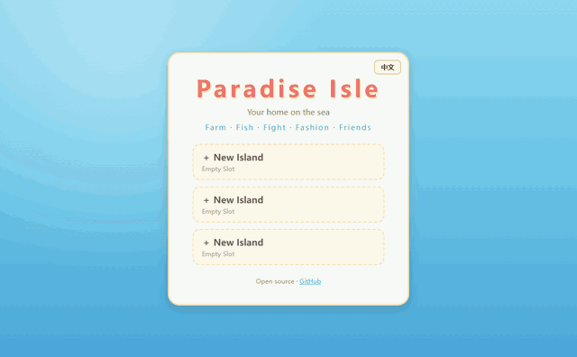

# 天堂小岛 Paradise Isle

一个浏览器里的海岛生活模拟游戏：种田、养动物、钓鱼、赶走野兽、换装、去邻居岛上串门。进度存在你自己的浏览器里，不需要账号。

**在线试玩：https://appleweiping.github.io/paradise-isle/**（电脑和手机都可以）



这是向 2011 年的网页游戏《QQ天堂岛》致敬的作品。玩法按原作的玩法重新实现，代码、美术、文案和数值都是新写的。

[English](README.md)

## 操作

| 动作 | 鼠标 | 触屏 |
|---|---|---|
| 对地块、动物、野兽或水边做事 | 点击它，角色会先走过去，再弹出小菜单（种植、浇水、收获、喂食、战斗、钓鱼……） | 点它 |
| 移动镜头 | 拖拽 | 单指拖动 |
| 缩放 | 滚轮 | 双指捏合 |
| 关闭菜单或面板 | `Esc`，或点外面 | 点外面 |
| 背包、商店、任务、图鉴、换装、邻居、布置、设置 | 底部工具栏 | 同左 |
| 切换语言 | 标题界面的 `EN` / `中文` 按钮，或游戏内的设置 | 同左 |

作物和动物按真实时间生长：胡萝卜 90 秒，后面的作物要几个小时，关掉网页也会继续长。回来时会弹出离线期间发生了什么的摘要。

| 中午的小岛 | 同一座岛的夜晚 |
|---|---|
|  |  |

## 本地运行

需要 Node.js 20 或更新版本。

```bash
git clone https://github.com/appleweiping/paradise-isle.git
cd paradise-isle
npm install
npm run dev      # http://localhost:5173
npm test         # 75 个单元测试（Vitest）
npm run build    # 类型检查 + 生产构建，输出到 dist/
```

CI 在每次 push 时跑类型检查、测试和构建，并把 `main` 部署到 GitHub Pages。

## 实现要点

- **TypeScript + Vite + Canvas 2D，没有运行时依赖。**
- **游戏规则不碰 DOM。** `src/core/` 里的每个玩法都是“状态 + 显式时间戳 `now`”的函数，比如 `harvest(state, plotUid, now)`；离线结算用的是同一套代码，测试直接在 Node 里调用。
- **没有图片文件。** 地形、作物、动物、建筑、服装和图标都由 `src/render/paint/` 里的代码在启动时画到离屏画布上；音效和音乐由 Web Audio 合成。
- **内容即数据。** 作物、动物、鱼、建筑、服装、宠物、邻居和任务都是 `src/data/` 里的表，加一种作物只要在 `crops.data.ts` 里加一行。
- **存档留在本地。** 3 个 `localStorage` 存档槽，带版本迁移和 base64 导入导出。好友码把岛屿快照用 LZW 压缩再转成 base64url，朋友粘贴就能来参观，不需要服务器；`npm run server` 可以启动一个可选的小服务，把长码换成短 id。

## 致谢

灵感来自《QQ天堂岛》（腾讯，2011）。本项目与腾讯无关，未获其授权或背书，也不包含其任何素材、代码或文案。

## 许可

[MIT](LICENSE)
